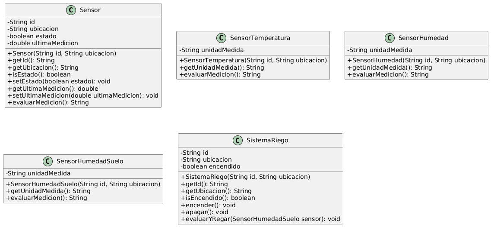

# Análisis y diseño

# Fase 1. Creación del proyecto, repositorio y análisis orientado a objetos

## 1. Descripción del problema
El sistema a representar consiste en un invernadero inteligente que monitoree temperatura del aire, humedad ambiental y humedad del suelo por medio de sensores. Tambien controlara un sistema de riego en base a las mediciones de las variables ambientales.
La informacion que necesita es la temperatura del aire, humedad ambiental, humedad del suelo, estado de los sensores, estado del sistema de riego, niveles deseados de las variables ambientales.
Los elementos que intervienen son las variables ambientales, los sensores, y el sistema de riego.
Debe poder encender y apagar sensores y obtener su medicion, y poder encender y apagar el sistema de riego.

## 2. Identificación de objetos
### Sensor
Representar a cualquier sensor del invernadero. Hay diferentes tipos de sensores, por lo que esta sera la clase padre y con ella se podra representar al sensor de cada variable ambiental, asi se podran controlar y usar sus mediciones de manera sencilla. Debe poder medir su variable correspondiente, la cual puede influenciar el encendido y apagado del sistema de riego, debe tener un ID, y una ubicacion.

### Sensor de Temperatura
Representa la especialización del sensor para medir e interpretar la temperatura del aire en el invernadero. Permite evaluar si el ambiente está dentro de los rangos óptimos de temperatura.

### Sensor de Humedad Ambiental
Representa la especialización del sensor para medir la humedad relativa del aire. Permite evaluar las condiciones de humedad en el ambiente del invernadero.

### Sensor de Humedad del Suelo
Representa la especialización del sensor para medir el nivel de humedad en la tierra. Esto determina si el suelo requiere agua y avisar al sistema de riego.

### Sistema de riego
Representa al sistema de riego del invernadero. Debe poder recibir los datos medidos de los sensores y modificar su propio estado en base a esto.

## 3. Estado y comportamiento
| Objeto propuesto | Responsabilidad | Información que debe conservar | Comportamientos que debe realizar |
|------------------|-------------------------------------------------------------------------------------------------------------------------------|-----------------------------|------------------------------------------------------------------------|
| Sensor | Medir una variable ambiental del invernadero | Medicion de la variable   Estado actual   Ubicacion   ID | Obtener medicion   Mandar valor medido   Encenderse y apagarse   Evaluar medicion |
| SensorTemperatura | Medir e interpretar la temperatura dentro del invernadero | Unidad de medida (°C)   Datos heredados de Sensor | Evaluar temperatura medida |
| SensorHumedad | Medir e interpretar la humedad del aire del invernadero | Unidad de medida (%)   Datos heredados de Sensor | Evaluar humedad ambiental medida |
| SensorHumedadSuelo | Medir e interpretar la humedad del suelo para determinar requerimientos de agua | Unidad de medida (%)   Datos heredados de Sensor | Evaluar humedad de suelo medida |
| Sistema de riego | Modificar el estado del sistema de riego en base a las mediciones de los sensores | Estado del sistema de riego   Ubicacion   ID | Obtener datos de los sensores   Encenderse y apagarse   Evaluar necesidad de riego |

## 4. Características comunes y especialización
La informacion que tienen en comun es el identificador, ubicacion, medicion y estado.
Su comportamiento en comun es la obtencion del valor medido, el cambio de estado, obtencion de ID y ubicacion.
Para cada tipo de sensor, si bien los tres miden datos, cada uno tiene su propia unidad e interpreta el valor medido de diferente manera.
Para representar a todos los sensores, se usara una clase padre que contendra los campos y metodos comunes.
Las clases especializadas de esta clase padre representaran a cada tipo de sensor, depediendo de la variable que midan.

## 5. Relaciones entre objetos
Los sensores y el sistema de riego deben colaborar. El sistema de riego necesita los valores medidos de los sensores del invernadero para modificar su estado.
Con herencia se puede representar la relacion entre el sensor general y cada sensor especializado.
No deben duplicarse responsabilidades de almacenamiento de datos. El sistema de riego los recibe pero no los almacena.
El sistema de riego no debe ser subclase de sensor ya que no tienen campos ni metodos en comun.

# Fase 2. Diseño orientado a objetos y UML

## Diseño de clases

| Clase | Atributos propuestos | Tipo de dato | Métodos propuestos | Responsabilidad |
|---|---|---|---|---|
| Sensor | id   ubicacion   estado   ultimaMedicion | private String   private String   private boolean   private double | getId   getUbicacion   isEstado   setEstado   getUltimaMedicion   setUltimaMedicion   evaluarMedicion | Servir como superclase base para representaciones de sensores, contiene los datos comunes y define su comportamiento general. |
| SensorTemperatura | unidadMedida | private String | getUnidadMedida | Representar de forma especializada la medición de la temperatura dentro del invernadero. |
| SensorHumedad | unidadMedida | private String | getUnidadMedida | Representar de forma especializada la medición de la humedad ambiental en el invernadero. |
| SensorHumedadSuelo | unidadMedida | private String | getUnidadMedida | Representar de forma especializada la medición de la humedad del suelo. |
| SistemaRiego | id   ubicacion   encendido | private String   private String   private boolean | getId   getUbicacion   isEncendido   encender   apagar   evaluarYRegar | Representar el sistema de riego del invernadero, permitiendo modificar su estado en función de la lectura del sensor de humedad del suelo. |

## Diagrama UML inicial

## Justificación del diseño

### 1. ¿Por qué propusiste esas clases?
Porque modelan de manera lo suficientemente precisa los elementos físicos descritos en el problema del invernadero inteligente, así como sus funciones. Se propuso una clase base general para los dispositivos de medición, clases especializadas para cada variable ambiental analizada, y una clase independiente para el actuador encargado del control del agua. Estos elementos nos permiten cumplir con los requerimientos de funcionamiento del sistema.

### 2. ¿Cuál es la responsabilidad principal de cada una?
* **Sensor**: Servir como clase base para estandarizar los datos y comportamientos comunes de cualquier sensor del invernadero.
* **SensorTemperatura**: Especializarse en la medición de la temperatura del aire dentro del invernadero.
* **SensorHumedad**: Especializarse en la medición de la humedad del ambiente del invernadero.
* **SensorHumedadSuelo**: Medir el nivel de humedad en la tierra del invernadero.
* **SistemaRiego**: Representar el actuador físico del sistema de riego, permitiendo cambiar su estado en función de las lecturas de los sensores.

### 3. ¿Por qué determinados atributos serán private?
Para que sólo puedan ser accedidos mediante métodos públicos determinados, usando getters y setters.

### 4. ¿Qué información proporcionarás mediante los constructores?
El id y la ubicación de los sensores y del sistema de riego.

### 5. ¿Cuál será la superclase?
La clase Sensor.

### 6. ¿Qué clases serán subclases?
SensorTemperatura, SensorHumedad y SensorHumedadSuelo

### 7. ¿Por qué existe una relación “es un” entre ellas?
Porque los sensores de temperatura, de humedad y de humedad de suelo son versiones especializadas de un sensor, los cuales heredan las características del sensor base.

### 8. ¿Qué información o comportamiento decidiste colocar en la superclase?
Atributos comunes a cualquier sensor, tales como el id, la ubicación, el estado actual y la última medición registrada. También métodos generales de acceso y modificación de estos atributos.

### 9. ¿Qué elementos permanecerán en las subclases?
La unidad de medición utilizada, para poder identificar a qué corresponde el valor de medida obtenido.

### 10. ¿Por qué SistemaRiego no pertenece a la jerarquía de sensores?
Porque el sistema de riego no es un sensor, sino un actuador. No obtiene información del invernadero, solo actúa en base a la información obtenida de los sensores.

## Constructores y super

### 1. ¿Los constructores de la superclase se heredan?
No, cada clase debe declarar sus propios constructores, pero una subclase puede invocar al constructor de su superclase utilizando super().

### 2. Cuando creas un objeto de una subclase, ¿qué constructor se ejecuta primero?
Se ejecuta primero el constructor de la superclase y posteriormente el constructor de la subclase.

### 3. ¿Para qué utilizaste super(...)?
Se utilizó en los constructores de las subclases de sensores para enviar los parámetros comunes id y ubicacion al constructor de la superclase Sensor, evitando duplicar código y asegurando que la parte heredada del objeto quede correctamente inicializada.

### 11. ¿Qué decisiones tomaste para evitar duplicar responsabilidades?
Se colocaron todos los atributos id, ubicación y estado en la superclase Sensor para que las subclases los hereden automáticamente.

## Reflexión sobre la sobrescritura

### 1. ¿Qué método sobrescribiste?
El método interpretacionMedicion(), el cual está definido originalmente en la superclase Sensor y es implementado usando @Override en cada una de las subclases.

### 2. ¿Qué indica @Override?
Indica al compilador que el método que se está definiendo en la subclase tiene la intención de sobrescribir un método existente en la superclase.

### 3. ¿Por qué utilizaste el mismo nombre de método en las diferentes subclases?
Para que se haga la sobreescritura del método, el de la super clase y el da las subclases deben tener el mismo nombre.

### 4. ¿Qué ventaja tiene esto frente a crear un método completamente diferente para cada tipo de sensor?
Permite aprovechar el polimorfismo, con lo que es posible tratar a todos los sensores de la misma manera y así usar el mismo método, obteniendo una respuesta especializada para cada subclase.

## Enlace dinámico

| Tipo de referencia | Tipo real del objeto | Método que se ejecuta |
|---|---|---|
| Sensor | SensorTemperatura | SensorTemperatura.evaluarMedicion() |
| Sensor | SensorHumedad | SensorHumedad.evaluarMedicion() |
| Sensor | SensorHumedadSuelo | SensorHumedadSuelo.evaluarMedicion() |

### 1. ¿Por qué una referencia de tipo Sensor puede apuntar a un objeto SensorTemperatura?
Porque un SensorTemperatura es un Sensor mediante herencia. Una variable de la superclase puede almacenar un objeto de cualquiera de sus subclases.

### 2. ¿Puede una referencia SensorTemperatura apuntar directamente a cualquier objeto Sensor?
No, porque un Sensor general no necesariamente es de temperatura.

### 3. Cuando ejecutas sensor.evaluarMedicion(), ¿qué versión del método se ejecuta?
Se ejecuta la versión definida en la subclase del objeto real (SensorTemperatura, SensorHumedad o SensorHumedadSuelo).

### 4. ¿Cómo determina Java cuál implementación utilizar?
Mediante enlace dinámico, identificando el tipo real del objeto y llamando a su método sobrescrito correspondiente.

### 5. ¿Dónde puedes observar el polimorfismo?
Al guardar distintas subclases dentro de un mismo arreglo de tipo Sensor[]. A pesar de ser diferentes subclases, todas pueden ser agrupadas bajo Sensor.

### 6. ¿Dónde puedes observar el enlace dinámico?
Al recorrer el arreglo de sensores en un ciclo y ejecutar sensor.evaluarMedicion(), obteniendo la respuesta específica de cada subclase.
